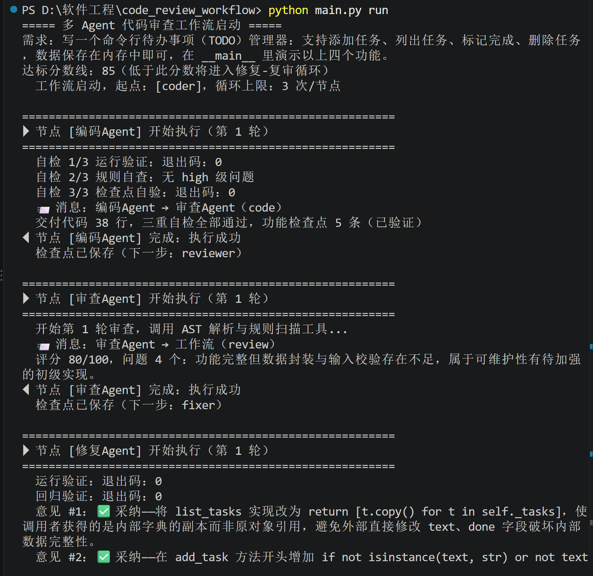
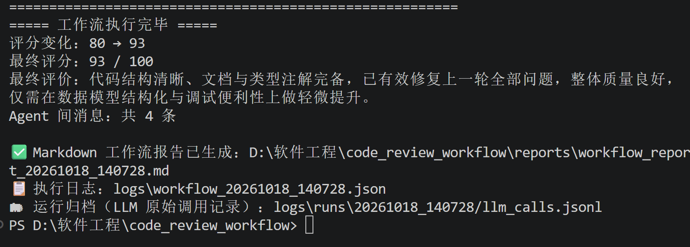
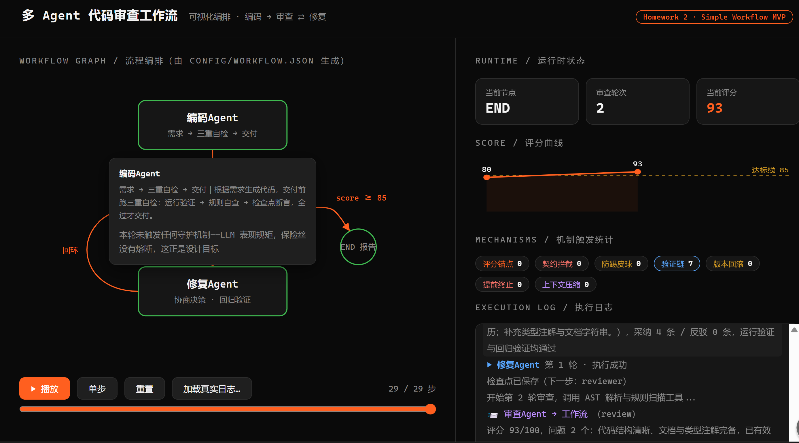
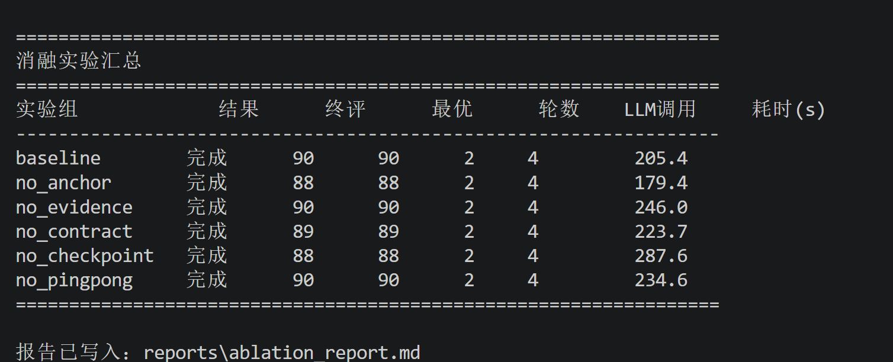

# 多 Agent 代码审查工作流（Homework 2）

三个 Agent 协作的代码审查流水线：**编码Agent → 审查Agent ⇄ 修复Agent**。
输入一句需求描述，编码Agent 生成代码并自测，审查Agent 双引擎打分，
低于 85 分自动进入「修复 → 复审」循环，直到达标或达到循环上限，
最终输出包含评分变化、问题清单、消息流的 Markdown 报告。

复用项目 1（Code Review Agent）的三个工具：AST 解析、规则引擎、代码执行器。

- **三 Agent 协作**：编码 / 审查 / 修复，各自独立角色与提示词
- **协商式协作**：修复Agent 可反驳不成立的审查意见并给出理由，审查Agent 下一轮裁定反驳是否成立——Agent 间是双向协商而非单向传话
- **Issue 生命周期跟踪**：每条问题有 open → fixed/rejected → resolved/unresolved/rejected_ok 完整状态机，审查Agent 复审时按编号逐条核销
- **版本回滚**：修复后分数回落时自动回滚到历史最优版本，保证质量单调向上
- **停滞检测**：连续两轮分数不提升时提前终止，不硬撑到循环上限
- **回归验证**：编码Agent 交付功能检查点，修复Agent 修完必须用自动生成的断言脚本证明功能没有回退——不只"能跑"，还要"没改坏"
- **上下文预算管理**：轮次记录超阈值时由 LLM 压缩成摘要，防止长会话撑爆上下文窗口
- **逐轮可追溯**：问题单带编号，报告含逐轮评分对比、修复决策记录、issue 生命周期表
- **状态共享 + 消息传递**：所有 Agent 读写同一个 WorkflowState，每次交付追加一条 AgentMessage
- **条件分支**：审查分数 ≥85 直接结束，<85 进入修复分支
- **循环控制**：修复后回到审查Agent 复审，单节点最多执行 3 次防死循环
- **执行日志与状态追踪**：每节点开始/结束/摘要实时显示，JSON 日志落盘 logs/
- **断点恢复**：每个节点完成后保存 checkpoint，崩溃后 `--resume` 续跑
- **启动时配置校验**：流程配置写错（未注册节点、非法循环上限、节点无出边等）在启动时立即报错，不跑到一半才崩
- **双层重试**：LLM 层仅对 429/5xx/网络错误退避重试（支持 Retry-After）；节点层对逻辑失败（JSON 解析等）再重试一次
- **配置驱动流程**：改 config/workflow.json 即可调整流程，新增 Agent 只需三步

## 项目结构

```
code_review_workflow/
├── main.py                # CLI 入口（run / --resume）
├── config/
│   └── workflow.json      # 流程定义：节点+边+条件+循环上限
├── core/
│   ├── engine.py          # 引擎：调度/分支/循环守卫/检查点
│   ├── state.py           # 共享状态 + Agent 间消息
│   ├── lifecycle.py       # issue 状态机 + 版本台账
│   ├── llm.py             # Kimi 客户端 + 分级重试
│   ├── conditions.py      # 安全条件求值器（不用 eval）
│   ├── schema.py          # LLM 输出契约校验
│   └── logger.py          # 终端显示 + JSON 落盘
├── agents/
│   ├── base.py            # Agent 节点基类（扩展接口）
│   ├── coder_agent.py     # 编码：生成 + 三重自检
│   ├── reviewer_agent.py  # 审查：规则+LLM 双引擎打分
│   ├── fixer_agent.py     # 修复：协商决策 + 回归验证
│   └── prompts.py         # 各 Agent 提示词
├── tools/                 # AST/规则引擎/执行器/检查点
├── report/
│   └── report_generator.py  # 运行报告生成
├── viz/
│   └── index.html         # 可视化回放页（双击打开）
├── gen_demo_log.py        # 演示数据生成脚本
├── run_ablation.py        # 消融实验入口
├── tests/                 # 90 个单元测试
├── examples/
│   └── demo_requirement.txt
├── requirements.txt
└── Design.md
```

补充说明：

- `viz/index.html`：演示数据已内嵌；日志里机制触发带徽章和统计，点击节点可看该轮动作明细。
- `core/lifecycle.py` 是从 `state.py` 拆出的规则层，让状态对象只留数据。
- `gen_demo_log.py` 用真实引擎 + Mock 节点生成演示日志，可视化页加载的就是它。

## 快速开始

```bash
# 1. 安装依赖（建议 Python 3.10+）
pip install -r requirements.txt

# 2. 配置 API Key：复制 .env.example 为 .env，填入 Kimi 的 Key
cp .env.example .env

# 3. 用内置示例需求启动工作流
python main.py run

# 4. 自定义需求
python main.py run "写一个命令行贪吃蛇游戏"

# 5. 崩溃后续跑 / 调整达标分数线 / 调整循环上限
python main.py run --resume
python main.py run --threshold 90
python main.py run --max-loops 5   # 覆盖 config/workflow.json 的 max_loops，不改配置文件
```

## 消融实验

每条核心机制都可以在 `config/workflow.json` 的 `ablation` 块里单独关掉。
跑消融实验会把同一份需求分别用"完整系统"和"关掉某条机制"各执行一次，对比退化情况：

```bash
python run_ablation.py              # 全部 6 组
python run_ablation.py --only no_anchor,no_contract   # 只跑指定组
python run_ablation.py --list       # 查看有哪些组
```

结束后控制台打印汇总表，并生成 `reports/ablation_report.md`。
注意：每组都是一次真实运行，会消耗 API 额度。

## 运行测试

```bash
python -m pytest tests/ -q
```

## 运行效果

### 一次完整运行（内置示例需求：命令行 TODO 管理器）



### 运行归档：每次运行的 LLM 原始调用都可逐条复查



### 可视化页面：回放协作过程，点击节点查看机制动作



### 消融实验：逐条关掉机制，看系统退化多少




## 设计文档

见 [Design.md](Design.md)：流程图、架构分层、状态与消息设计、要求符合度对照表。
